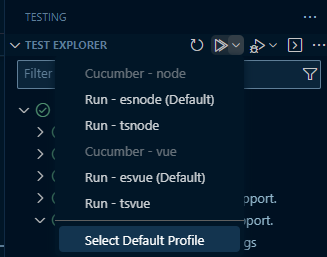
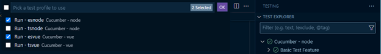
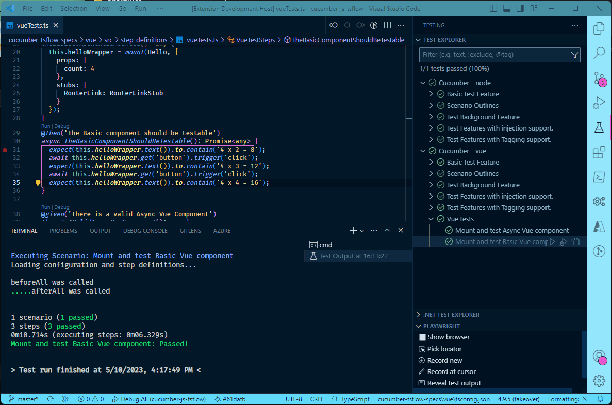

# Cucumber TsFlow for VS Code

This extension provides Run and Debug support for [cucumber-tsflow ](https://www.npmjs.com/package/@lynxwall/cucumber-tsflow) **v8.0.0** or greater in  [VS Code ](https://code.visualstudio.com/)version **1.90.0** or greater.

## Features

The latest release of this extension provides both Test Explorer and Code Lens support in VS Code to allow running and debugging Scenarios using cucumber-tsflow.

The following features have been implemented:

- **Support for multiple cucumber-tsflow test projects** - This extension will look for all cucumber configuration files and create separate run/debug profiles for each profile configuration that it finds. When a configuration has multiple profiles the Test Explorer will choose the `default` or first profile found in the associated cucumber configuration file. 

- **Ability to choose a default profile** - The Test Explorer provides an option to select a default profile that is used when running tests. The following screenshot shows the menu option provided to choose a default profile:
  

  When ***Select Default Profile*** is clicked the following dialog opens:

  
  
  **NOTE:** If multiple profiles are chosen for the same project your tests will be executed for each profile, which may not be desired.
  
- **Code Lens support** - Adds Run and Debug commands to each Given, When, Then step found in a Cucumber step file. In addition, RunAll and DebugAll commands are added to classes in a step file that are annotated with a @binding decorator.

  **NOTE**: Code Lens support will use the first (Default) profile selected for each project in the Test Explorer, shown above. If a (Default) profile isn't found it will use the cucumber `default` profile or the first profile found in the associated cucumber configuration file.

- **One cucumber-tsflow process per run** - Running a scenario, a feature, a selection or the whole suite starts cucumber-tsflow once per cucumber configuration and passes every selected scenario to it, so the support code loads once instead of once per scenario. Results are read from cucumber's message stream, so every scenario still gets its own result and duration and a failing step reports its error with a link to the step in the feature file. See [How tests run](#how-tests-run).

- **Scenario Outline examples** - Each example row of a Scenario Outline is its own test item under the outline, labelled with the example's title (plus the row's values when the title has no `<placeholder>`), so the Test Explorer counts, runs and reports examples the way the CLI does. A single example can be run or debugged on its own.

- **Run and debug from the feature file** - Test items carry their line in the feature file, so the run and debug icons in the editor gutter of a `.feature` file and the `Test: Run Test at Cursor` command work alongside the Test Explorer and Code Lens.

- **Live output** - Everything cucumber-tsflow writes while it runs is shown in the Test Results view as it happens, for both run and debug.

The following animation shows multiple projects with multiple profiles in each project (cucumber configuration). In addition, the animation demonstrates debugging one of the steps from the Test Explorer.



The execution of Cucumber tests is accomplished by referencing a feature or a scenario within a Cucumber Feature file.  When a step definition file is opened in VS Code, this extension will map the steps it finds with features and scenarios that you have defined. 

### Hooks (beforeAll, before, beforeStep, afterAll, after, afterStep)

This extension **does not** add Code Lens actions to cucumber-tsflow hooks. However, you can add ***breakpoints*** to code in a hook step and then ***Debug*** a scenario that should invoke the hook.

### Additional Features

- **Support for "multi-root" or "monorepo" projects** - When  a workspace with ***.feature*** files is loaded this extension will search for the first node_modules folder that contains cucumber-tsflow. From there, it will look for all cucumber configuration files and initialize a new test profile in the Test Explorer for each configuration found.
  **NOTE:** With **Isolated** **node_modules** used by pnpm or other package managers configured to use isolated node_modules, **cucumber-tsflow** should be installed in the workspace root project. 
- **Uses [cucumber configuration ](https://github.com/cucumber/cucumber-js/blob/v12.7.0/docs/configuration.md) profiles to execute tests in cucumber-tsflow** - You can specify the profile to use in your tests through VS Code Test Explorer settings. The default configuration uses the `default` profile, or first one found if `default` isn't defined in your cucumber configuration.

## Future Releases

Planned future releases include the following:

- Code snippet generation - Currently cucumber-tsflow will generate code snippets in the terminal output when not able to find matching code for a step. This update will provide the ability to generate complete step definition files for a feature or snippets for scenarios and steps.

## Requirements

This extension requires the following:

- [cucumber-tsflow ](https://www.npmjs.com/package/@lynxwall/cucumber-tsflow) version **8.0.0** or higher.
- [Node.js ](https://nodejs.org/) version **22** or higher on the path, which cucumber-tsflow 8 requires.
- [vscode ](https://code.visualstudio.com/) version **1.90.0** or higher (the first release whose extension host runs Node.js 20, which the bundled file-matching libraries need).

Projects that are still on cucumber-tsflow 7.x should use version 2.3.0 of this extension.

The extension checks the version of cucumber-tsflow installed in your project when it activates. If it is older than 8.0.0 nothing is registered, and the reason is written to the **Cucumber TsFlow** output channel (View > Output).

## Step files and ES Modules

Step files are discovered from the `require` **and** `import` settings of every profile in a cucumber configuration, so Code Lens works for both CommonJS and ES Module projects. Features are loaded from the `paths` setting of the `default` profile (or the first profile when there is no `default`).

## How tests run

The extension does not run cucumber in-process. Each run or debug request starts **one** process per cucumber configuration, using the `cucumber-tsflow` command installed in your project, from the folder that holds the configuration file:

```text
node <project>/node_modules/@lynxwall/cucumber-tsflow/bin/cucumber-tsflow -p <profile> [-c <configFile>] [--selective-load] --format message <feature>[:<line>] ...
```

- **Which paths are passed** - A run that covers every feature of a configuration passes no paths at all, so cucumber expands the profile's `paths` itself and runs the features in the same order as `cucumber-tsflow -p <profile>` from a terminal. Any other run passes the selected items: a feature whose scenarios are all selected as the file, a Scenario Outline whose examples are all selected as `<feature>:<outline line>`, and everything else as `<feature>:<line>`. The paths are sorted the way cucumber sorts a glob's matches, because cucumber runs explicit paths in the order given and some suites depend on that order. A list that would exceed the command-line limit is split across several processes.

- **Selective loading** - The `selectiveLoad` setting adds `--selective-load` to filtered runs, which lets cucumber-tsflow 8.0 skip the support files the selected scenarios do not use. It is off by default because the index behind it only knows files that register steps or hooks: a support file that only sets up state when it is imported (a mapper registration, a global) is skipped, and a scenario that relies on it passes in the full suite but fails on its own. Turn it on when every support file registers something; a full run loads everything anyway and never passes the flag.

- **Results** - Results come from cucumber's message stream (`--format message`), not from the exit code. Each scenario and each example is marked passed, failed or skipped as cucumber finishes it, and a failing step reports its error with a link to the step in the feature file. If the process exits with an error before any scenario starts (a configuration error, an unhandled exception, a failing `BeforeAll` hook), every requested item is marked errored with the tail of the output.

- **Output** - cucumber-tsflow 8.0 writes its own configuration and progress lines to stderr. That output, and anything your support code prints with `console.log`, is shown in the Test Results view as it arrives. A summary line with the counts and the exit code closes each run.

- **Debugging** - Debug starts the same process with the Node inspector listening on port 9777 and attaches a `node` debug session named `Attach Cucumber-tsflow Debug`; the `debugOptions` setting adds to or overrides that attach configuration. Breakpoints in step files, hooks and the code under test all work.

## Troubleshooting

- **The Test Explorer is empty** - Open the **Cucumber TsFlow** output channel. It reports the version of cucumber-tsflow found under the project path, or that version 8.0.0 or higher is required when the install is missing or too old. If the channel stays empty the extension found no `node_modules/@lynxwall` folder under the workspace; the `projectPath` setting points it at the folder whose `node_modules` holds cucumber-tsflow.

- **A scenario is missing from the tree** - Test item ids are derived from titles, so two scenarios in the same feature with the same title collide. The second one is skipped and reported in the output channel as `Duplicate scenario found`; give it a distinct title.

- **A selection fails but the full run passes** - Scenarios that depend on state left behind by an earlier feature pass only when that feature ran first in the same process. A filtered run passes its features in cucumber's sorted order, but anything that relies on a feature outside the selection having run will fail on its own. Run the same `<feature>:<line>` arguments from a terminal to confirm; the fix belongs in the suite.

## Extension Settings

This extension should support most projects with it's default configuration. However, several configuration settings have been provided to support different project structures and cucumber configurations.

Settings for this extension all start with `cucumber-tsflow` and would normally be added to a ***settings.json*** file in your workspace under the `.vscode` folder. You can also add cucumber-tsflow settings to your global user settings.

For example, if you wanted to disable the CodeLens feature you would add the following to ***settings.json***:

`"cucumber-tsflow.disableCodeLens": true`

This extension contributes the following settings:

| Setting                   | Type    | Default                               | Description                                                  |
| ------------------------- | ------- | ------------------------------------- | ------------------------------------------------------------ |
| `configFile`              | string  |                                       | Cucumber config file (relative to cucumber-tsflow.projectPath e.g. './test/cucumber.json') |
| `projectPath`             | string  |                                       | Absolute path, or relative path starting with './' from workspace root, to the project directory where packages.json and node_modules are found (e.g. /home/me/project/web/sub-folder or ./web/sub-folder) |
| `runOptions`              | array   |                                       | Add [CLI Options ](https://github.com/LynxWall/cucumber-js-tsflow#new-configuration-options) to the Cucumber-tsflow Command. (e.g. ['--backtrace', 'true']) |
| `debugOptions`            | object  |                                       | Add or overwrite vscode debug configurations (only in debug mode) (e.g. { \"args\": [\"--no-cache\"] }) |
| `disableCodeLens` | boolean | false | Disable Code Lens feature |
| `preserveEditorFocus`     | boolean | false                                 | Preserve focus on editor when running tests                  |
| `selectiveLoad`           | boolean | false                                 | Pass `--selective-load` to cucumber-tsflow on filtered runs so they load only the support files the selected scenarios use. Off by default: a support file that only sets up state at import time, without registering a step or hook, is skipped by selective loading, and scenarios that rely on it fail when run on their own. |

## Change Log

See the Change Log [here ](CHANGELOG.md)

## Issues

Submit [issues ](https://github.com/LynxWall/cucumber-tsflow-vscode/issues) if you find any bug or have any suggestions.

## Enjoy!
